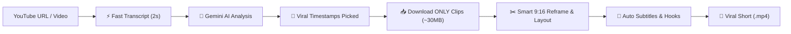

# OpenShorts

**The open-source AI video clipping and viral shorts platform.** Turn long YouTube videos, podcasts, and streams into viral 9:16 Shorts, TikToks, and Reels with zero wasted bandwidth.

| Feature | OpenShorts | OpusClip | Vizard | Klap |
|---|---|---|---|---|
| **Open source** | **Yes (MIT)** | No | No | No |
| **Self-hostable** | **Yes (Local / Docker)** | No | No | No |
| **Pre-download clipping (saves 90% bandwidth)** | **Yes** | No | No | No |
| **2-Second YouTube Caption Fetch** | **Yes** | No | No | No |
| **Unlimited clip generation** | **Yes (No artificial limits)** | No | No | No |
| **Free without watermark** | **Yes** | No | No | No |
| **API + MCP server** | **Yes** | API only | API only | API only |

[](https://opensource.org/licenses/MIT)
[](https://opensource.org/)
[](https://docs.docker.com/compose/)

---

## ⚡ What Makes OpenShorts Different?

### 1. 2-Second Transcript Extraction ⚡
Instead of downloading a 1GB+ video file and waiting minutes for Whisper transcription, OpenShorts fetches native YouTube captions directly in **under 2 seconds** using specialized mobile client targets. (Falls back to `faster-whisper` automatically only when captions are unavailable).

### 2. Pre-Download Viral Detection (Saves 90% Bandwidth) 🧠
Gemini AI analyzes the lightweight transcript **BEFORE** downloading the video. It pinpoints the exact viral moments and timestamps. OpenShorts then downloads **only those specific segments** (~30–40 MB total instead of 500 MB – 1 GB+ full video files).

### 3. Unlimited Clips with Strict Non-Overlapping Timestamps 🎯
No artificial 6-clip limit — generate as many viral clips as exist in long podcasts or videos. Built-in deduplication ensures timestamps never collide or overlap between clips.

### 4. Gaming & Streamer Auto-Framing 🎮
Intelligent layout detection recognizes streamer facecams and gameplay screens, automatically composing split-views or stacked layouts with subtitles placed cleanly on the seam.

### 5. Social-Ready File Downloads with Captions & Hashtags 📱
Exported clips automatically save with their generated TikTok/Instagram captions and `#hashtags` as the filename (e.g. `Gordon Ramsay Calls Him an Idiot Sandwich! #Cooking #Shorts.mp4`), sanitized for Windows, macOS, and Linux.

---

## 🛠️ 3 Tools in 1 Platform

### 1. Clip Generator
Turn your long-form videos — podcasts, webinars, livestreams, vlogs, gaming streams — into viral-ready 9:16 shorts for TikTok, Instagram Reels, and YouTube Shorts.
- **Smart 9:16 Cropping**: AI reframing per scene — TRACK mode (MediaPipe + YOLOv8 face tracking), GENERAL mode (blurred background), SPLIT mode (two speakers stacked), and STREAMER/GAMEPLAY mode.
- **Auto Subtitles**: Word-level synchronized timestamps with karaoke and classic animated styles.
- **AI Voice Dubbing**: ElevenLabs integration for 30+ languages with voice cloning.
- **AI Hook Overlays**: Attention-grabbing hook text overlays generated for high retention.

### 2. AI Shorts (UGC Video Creator)
Generate marketing videos with AI actors for any product or business.
- Script writing with AI (Hook - Problem - Solution - CTA).
- AI talking avatars with lip-sync (`fal.ai` Flux + Hailuo / Kling).
- Automated B-roll, Ken Burns motion effects, and subtitles.

### 3. YouTube Studio
Free AI YouTube toolkit:
- AI thumbnail generator with custom face overlay.
- 10 viral title suggestions with refinement chat.
- Auto-generated chapter timestamps and descriptions.
- Direct social publishing via Upload-Post.

---

## 🚀 Technical Pipeline



1. **Ingest & Captions**: Direct YouTube subtitle extraction in 2 seconds; local video upload supported.
2. **AI Analysis**: Gemini Flash-Lite analyzes transcript windows and ranks moments by hook, virality, and emotional engagement.
3. **Targeted Extraction**: yt-dlp fetches only the selected time intervals with zero redundant download.
4. **Auto-Reframing**: MediaPipe & YOLO face/subject tracking crops 16:9 to vertical 9:16.
5. **Captions & Branding**: Synchronized ASS subtitles with customizable colors, fonts, and karaoke effects.
6. **Download / Publish**: Direct download with caption & hashtag filenames or scheduled auto-posting to TikTok, YouTube, and Instagram.

---

## 💻 Getting Started

### Prerequisites
- Python 3.10+ and Node.js 18+ (or Docker)
- FFmpeg installed and available on system PATH
- [Google Gemini API Key](https://aistudio.google.com/app/apikey) (Free tier available)

---

### Option A: Local Development (Recommended)

#### 1. Clone the repository
```bash
git clone https://github.com/mutonby/openshorts.git
cd openshorts
```

#### 2. Setup Python Backend
```bash
# Create virtual environment
python -m venv .venv

# Activate virtual environment
# Windows:
.\.venv\Scripts\activate
# Linux/macOS:
source .venv/bin/activate

# Install dependencies
pip install -r requirements.txt
```

#### 3. Setup Frontend Dashboard
```bash
cd dashboard
npm install
cd ..
```

#### 4. Configure Environment
Create a `.env` file in the root directory:
```env
GEMINI_API_KEY=your_gemini_api_key_here
MAX_CONCURRENT_JOBS=5
FFMPEG_ENCODER=auto
```

#### 5. Run Backend & Frontend
In Terminal 1 (Backend):
```bash
uvicorn app:app --host 0.0.0.0 --port 8000
```

In Terminal 2 (Frontend):
```bash
cd dashboard
npm run dev
```

Open your browser at **`http://localhost:5173`**.

---

### Option B: Docker Compose

```bash
# Build and run with Docker Compose
docker compose up --build
```
Navigate to **`http://localhost:5175`** (or configured port).

---

## ⚙️ Configuration & Environment Variables

| Variable | Description | Default |
|---|---|---|
| `GEMINI_API_KEY` | Google Gemini API key for viral moment selection & script analysis | Required |
| `LLM_BASE_URL` | Optional local LLM endpoint (Ollama, LM Studio, vLLM) | None |
| `LLM_MODEL` | Local LLM model name (e.g. `qwen2.5:14b`, `llama3.1:8b`) | `llama3.1:8b` |
| `ELEVENLABS_API_KEY` | ElevenLabs API key for AI voice dubbing and TTS | Optional |
| `FAL_KEY` | fal.ai key for UGC AI actor generation and video lip-sync | Optional |
| `UPLOAD_POST_API_KEY` | Upload-Post API key for direct social media publishing | Optional |
| `MAX_CONCURRENT_JOBS` | Maximum concurrent background clipping jobs | `5` |
| `FFMPEG_ENCODER` | FFmpeg video encoder (`auto`, `h264_nvenc`, `libx264`) | `auto` |
| `WHISPER_MODEL` | Fallback Whisper model (`base`, `small`, `large-v3-turbo`) | `base` |

---

## 🤖 MCP Server & API Automation

OpenShorts includes a built-in [Model Context Protocol (MCP)](https://modelcontextprotocol.io) server so agents like Claude Code, ChatGPT, or Cursor can clip videos automatically:

```bash
# Claude Code / Cursor / MCP Clients
claude mcp add --transport http openshorts http://localhost:8000/mcp

# Or stdio transport without running web server
claude mcp add openshorts -- python mcp_stdio.py
```

### Available Tools:
- `process_video`: Give a YouTube URL to automatically extract viral clips.
- `get_job_status`: Check real-time progress and logs.
- `list_clips`: Fetch metadata, video URLs, captions, and timestamps.
- `add_subtitles`: Burn customized subtitles and karaoke styles.
- `publish_clip`: Publish directly to TikTok, Instagram, and YouTube.

---

## 🤝 Contributing

Contributions are warmly welcomed!
1. Fork the Project
2. Create your Feature Branch (`git checkout -b feature/AmazingFeature`)
3. Commit your Changes (`git commit -m 'Add some AmazingFeature'`)
4. Push to the Branch (`git push origin feature/AmazingFeature`)
5. Open a Pull Request

---

## 📄 License

Distributed under the **MIT License**. See `LICENSE` for more information.
